# Arquitectura del framework BMAD

BMAD es un motor Python que orquesta agentes de IA por roles sobre workspaces de proyecto
aislados. El motor (`ENGINE_ROOT`) se instala una vez y aporta runtime, perfiles, skills,
plantillas y dashboard. Cada proyecto (`WORKSPACE_ROOT`) conserva su identidad, configuración,
entregables, código, especificaciones, tracker y estado. El framework no impone el stack de
la aplicación: cada workspace lo define o lo descubre en su propia constitución técnica.

Este documento describe la arquitectura implementada. Instalación y configuración están en
[SETUP.md](SETUP.md); operación diaria en [GUIDE.md](GUIDE.md); el contrato por módulo
(funciones, consumidores y efectos) en [bmad_runtime/README.md](bmad_runtime/README.md).

## 1. Contexto del sistema

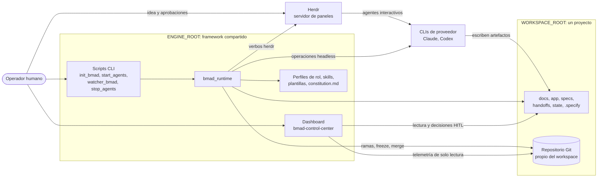

- El operador entrega la idea en el panel de Business Storyteller y atiende las compuertas
  humanas desde CLI (`utils/approve_step.py`, `utils/response_sa.py`) o el dashboard.
- Gemini está registrado en el adaptador, pero no construye comandos ejecutables.
- El motor no instala Herdr ni los CLIs de proveedor; los invoca como procesos externos.

## 2. Componentes

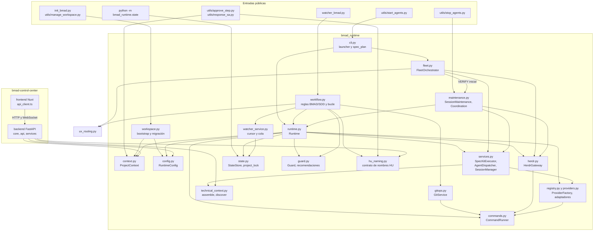

| Componente | Módulos | Responsabilidad |
|---|---|---|
| Identidad y perímetro | `context.py` | Selección por CLI, entorno o registro; `output()` rechaza escapes, enlaces y rutas ambiguas; nombres de sesión `ID-hash-rol`; contrato de rutas para agentes |
| Bootstrap | `workspace.py`, `technical_context.initialize_constitution` | Scaffolding aditivo, constitución local neutral y migración legacy explícita |
| Configuración | `config.py` | Fusión global + `project.json`; resolución `defaults → fase → agente u operación` |
| Proveedores | `registry.py`, `providers.py` | Adaptadores Claude/Codex/Gemini, traducción de effort, verificación de flags y skills |
| Ejecución de procesos | `commands.py` | argv sin shell, timeout, límite de salida y de concurrencia por runner |
| Composición | `runtime.py` | Construye config, fábrica, runner, gateway, estado y servicios de un contexto |
| Flota interactiva | `cli.py`, `fleet.py`, `herdr.py` | 3 tabs y 13 paneles (12 sin UX); propiedad registrada en SQLite |
| Servicios | `services.py` | Spec Kit headless, despacho a paneles propios, resúmenes y plan de sesiones, verificación de mantenimiento |
| Contexto técnico | `technical_context.py` | Índice por rol/operación, descubrimiento acotado del stack y ensamblado del prompt |
| Estado | `state.py`, `watcher_service.py` | Registros JSON en SQLite, claims idempotentes, locks de SO, cursor y cola del tracker |
| Flujo BMAD/SDD | `workflow.py`, `ux_routing.py`, `gitops.py` | Interpretación del tracker, compuertas, fases SDD, retrabajo y macros GitOps |
| Nombres de HU | `hu_naming.py` | Contrato único `NNN-nombre-en-kebab-case.md` para watcher, GitOps, `approve_step.py` y dashboard; rechaza sin renombrar |
| Mantenimiento | `maintenance.py` | Cierre de tabs propios idle/done; VERIFY de identidad; CLEAR (Claude) y ROTATE confirmados por el operador, coordinados con el watcher |
| Presupuesto y bucles | `guard.py` | Eventos de progreso con calidad de métrica, presupuesto y loop guard; alertas `WARNING`/`PAUSE`/`REQUIRES_INTERVENTION`; en `enforce` retiene nuevos despachos; nunca limpia, rota ni reintenta |
| Dashboard | `bmad-control-center/` | Proyección de un workspace por proceso API: tracker, artefactos, gates, Git y eventos |

`watcher_bmad.py` reexporta `workflow` mediante `sys.modules`, por compatibilidad de imports.
El dashboard no consulta Herdr ni SQLite: lee el tracker, los archivos del perímetro y Git.

## 3. Estructura lógica de carpetas

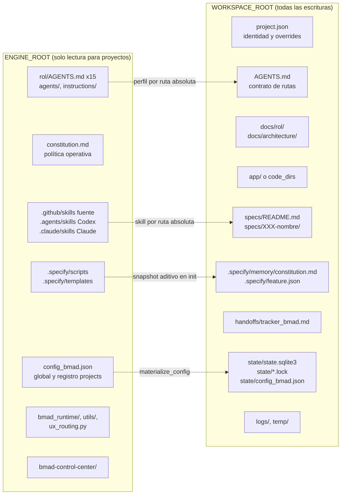

- Perfiles y skills se leen del motor por ruta absoluta; no se copian al workspace.
- `ProjectContext.validate()` rechaza un workspace igual al motor, que lo contenga o que se
  superponga con sus directorios compartidos.
- `state/config_bmad.json` es una vista generada; los orígenes editables son
  `config_bmad.json` del motor y `project.json`.
- En modo legacy (configuración sin registro `projects`) el tracker vive en `docs/` y el
  estado en `.bmad-runtime/`. El template incluye el registro, así que siempre exige selección.

## 4. Flujo de datos y persistencia

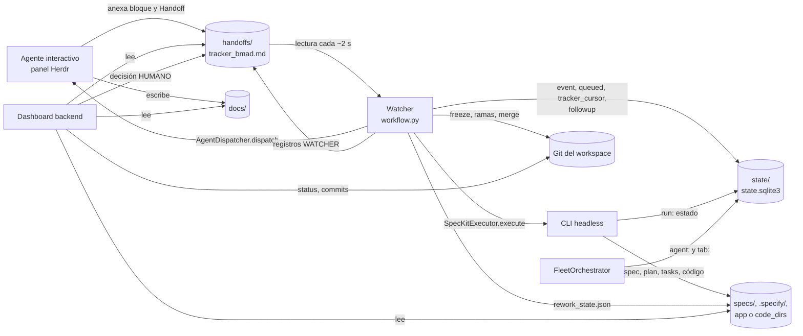

| Almacén | Contenido | Escritor |
|---|---|---|
| `handoffs/tracker_bmad.md` | Bus de handoffs: bloques `### [fecha] Autor` con artefacto, estado y línea `Handoff` | Agentes, watcher, scripts humanos, dashboard |
| `state/state.sqlite3`, tabla `records(id, data)` | `agent:`, `tab:`, `run:`, `dispatch:`, `event:`, `queued:`, `tracker_cursor`, `followup`, `session:`, `maintenance:`, `watcher`, `progress:`, `guard_alert:`, `guard_ack:`, `guard_artifacts`, `hu_lifecycle`, `hu_lifecycle:` (observación de HU, no autoritativa), `hu_authority`, `hu_op:`, `hu_resolution:` (Fase 4F-E4, solo con `enforce`) | Flota, servicios, watcher, mantenimiento, guard |
| `state/*.lock` | Locks de SO `bootstrap`, `fleet`, `watcher`, `speckit`, `maintenance`, `sessions` (el watcher lo toma en cada ciclo), `hu` (E4: apertura/cierre de HU, por proyecto) | `project_lock()`, `ProjectLock` |
| `.specify/memory/` | Constitución local, `rework_state.json`, `rework_last_classification.md` | Spec Kit, QT, watcher |
| `docs/`, `specs/`, `app/` | Entregables por rol, especificaciones y código | Agentes y CLIs headless |
| `logs/guard.log` | Alertas del guard (JSONL) cuando suben de nivel | `guard.py` |

SQLite guarda metadatos, no prompts ni credenciales. La cola persiste la referencia (línea,
hash y offsets) a la instrucción del tracker; al reanudar no se vuelve a extraer la línea, para
no repetir macros Git o fases SDD.

## 5. Ciclo de vida de un proyecto

El runtime no persiste un estado global del proyecto; el ciclo se deduce de artefactos,
registros y procesos en ejecución.

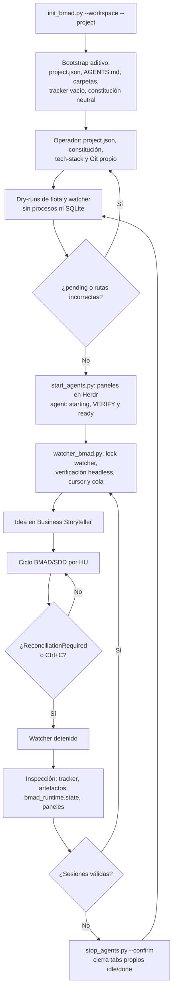

## 6. Flujo BMAD + SDD

BMAD reparte el trabajo en 15 roles y cuatro fases (B negocio, M gestión, A arquitectura,
D desarrollo, según `AGENT_PHASES`). SDD mantiene `spec.md`, `plan.md` y `tasks.md` por HU
mediante siete operaciones Spec Kit (`specify`, `clarify`, `plan`, `tasks`, `analyze`,
`converge`, `implement`) que el watcher ejecuta en modo headless.

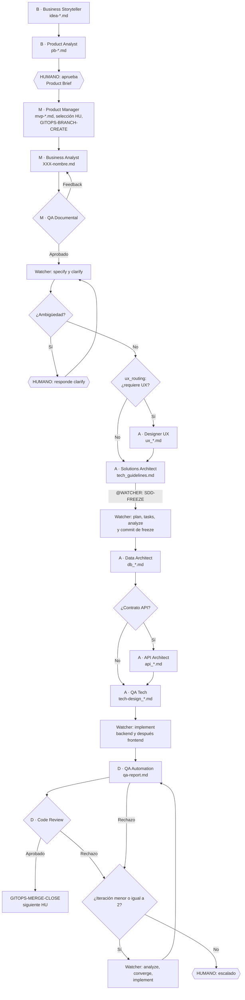

Reglas de gobierno implementadas o exigidas por perfiles y watcher:

- **Vertical slicing:** una HU recorre el flujo completo antes de abrir la siguiente.
- **Identificador universal:** `XXX-nombre-en-kebab-case` se conserva en HU, carpeta
  `specs/XXX-nombre/`, rama `feat/XXX-nombre` y handoffs. El watcher fija
  `SPECIFY_FEATURE_DIRECTORY` y verifica `.specify/feature.json`; una divergencia detiene la fase.
  `bmad_runtime/hu_naming.py` valida el nombre en todos los consumidores (watcher, GitOps,
  `approve_step.py` y dashboard); un nombre inválido detiene solo el paso de esa HU, sin
  renombrar, sin carpeta elegida por Spec Kit y sin rama genérica.
- **Ledger:** `specs/README.md` con columnas `N° | Épica Origen | Nombre spec / HU | Qué aporta | Estado | Rama`.
- **UX:** `project_type=headless` o `ux_phase=off` omiten UX; `on` lo fuerza; `auto` lee
  `Requiere interfaz: Sí|No` en la HU y, si falta, diseña.
- **Implementación:** backend y frontend no tienen panel; Spec Kit `implement` monta sus perfiles
  como directiva y exige actualizar `docs/dev-backend/backend-architecture.md`,
  `docs/dev-frontend/frontend-architecture.md` y los README de cada `code_dirs`.
- **Retrabajo:** un rechazo de QA Automation o Code Review activa `analyze → converge → implement`
  sobre las tareas de corrección; tras dos iteraciones se escala al humano.
- **Cambio de stack:** no existe catálogo de stacks ni comando de sustitución. Se ajustan
  constitución local, guías y tareas del workspace.

## 7. Estados implementados

### Registro de agentes de la flota (`agent:<rol>`)

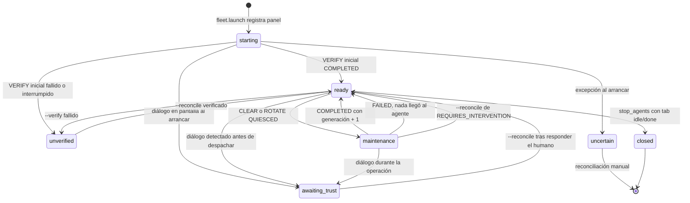

`HOLD_STATES` (`starting`, `awaiting_trust`, `unverified`, `maintenance`) retienen las tareas:
solo un registro `ready` recibe despachos, y solo si su panel, proveedor y modelo coinciden con
la selección vigente y su `agent_status` en Herdr es `idle` o `done`. VERIFY comprueba la
identidad de forma determinista (nombre de sesión, proveedor y modelo, panel, `cwd`, proceso y
contrato cargado) y después la respuesta del agente a una sonda `BMAD-VERIFICACION` (rol,
proyecto, workspace, digest del contrato y memoria). Ningún diálogo se responde de forma automática.

### Operaciones idempotentes (`event:`, `dispatch:`, `run:`)

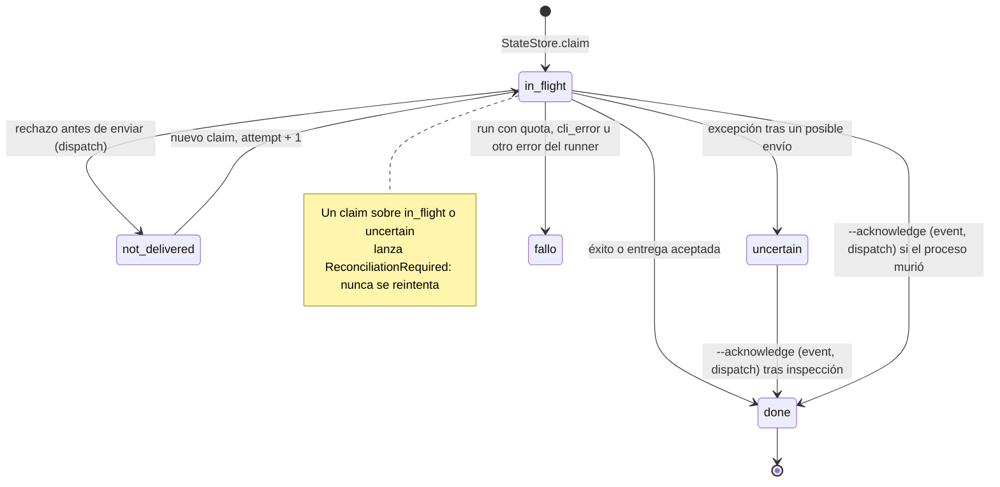

`fallo` agrupa los valores de `provider.classify()` y del runner (`quota`, `cli_error`,
`cli_missing`, `native_executable_required`, `process_limit`, `spawn_failed`, entre otros).
No hay reintento automático: el workflow registra el error en el tracker y se detiene o pausa.
`--acknowledge` (`python -m bmad_runtime.state`) marca el registro como atendido y nunca lo repite.

### Handoff en cola (`queued:`) y confirmación

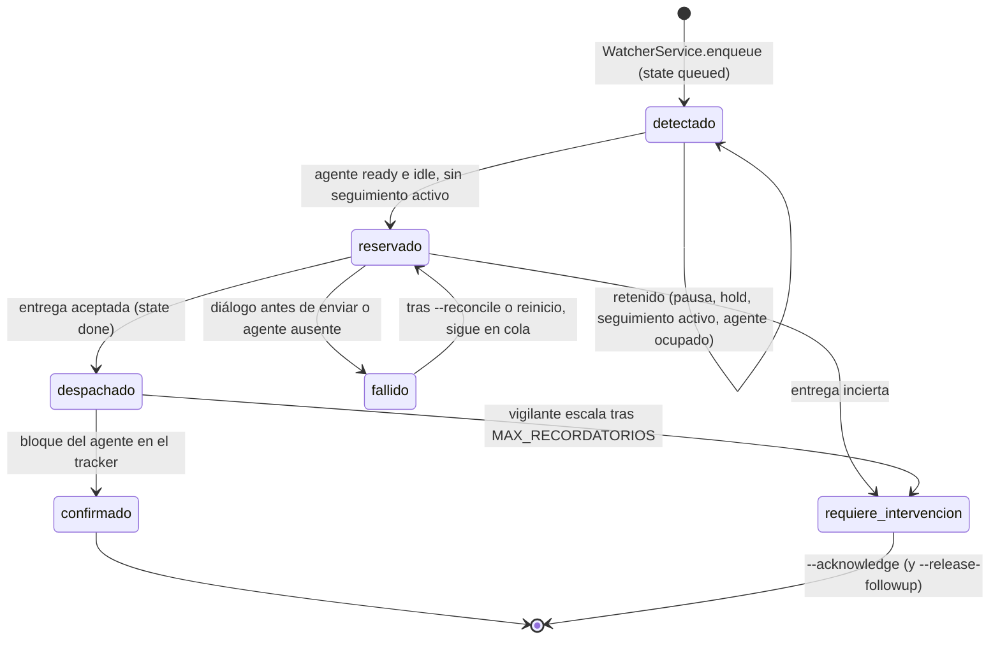

El campo canónico `state` (`queued` o `done`) decide si la tarea sigue en cola; `stage` es
trazabilidad. Un despacho abre un seguimiento (`followup`) para el agente: mientras no aparezca
su bloque, ni la escalada del vigilante, el mismo agente no recibe otra tarea aunque Herdr lo
muestre `idle`, y la siguiente queda en `detectado`. El bloque confirmado registra el resumen
`session:<rol>`; un bloque de agente sin despacho es `protocol_violation:` y detiene los despachos.

### Watcher

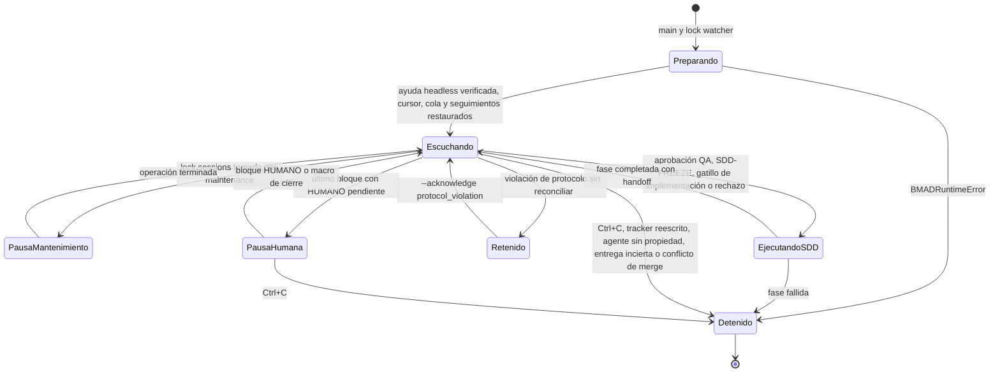

En cada ciclo (~2 s) el watcher toma el lock `sessions`, publica su latido (`watcher`, protocolo
`sessions-lock/1`) y lee solo líneas completas coherentes con el cursor. Además de las pausas
globales, cada tarea se retiene por agente: mantenimiento sin reconciliar, `HOLD_STATES`, alerta
del guard en modo `enforce`, seguimiento activo o agente ocupado en Herdr. La pausa humana no se
persiste: `is_tracker_paused_for_human()` la recalcula leyendo el último bloque con handoff. Una
detención por `ReconciliationRequired` sale con código 1 y exige inspección antes de reanudar.

### Una HU abierta por proyecto (Fase 4F-E4, `ai.hu_lifecycle.mode = enforce`)

Política: cada proyecto mantiene como máximo una HU abierta desde su `GITOPS-BRANCH-CREATE` autorizado
hasta que su `GITOPS-MERGE-CLOSE` se completa y Git lo verifica. Varios agentes trabajan sobre la HU
abierta; proyectos con repositorios independientes avanzan en paralelo (el lock `hu` está en el
directorio de estado de cada proyecto; no existe un bloqueo global). `observe` (por defecto) y `off`
conservan el comportamiento anterior. `enforce` solo se activa explícitamente: `ai.hu_lifecycle` del
motor o, para un proyecto aislado, `config.ai.hu_lifecycle` en su `project.json`.

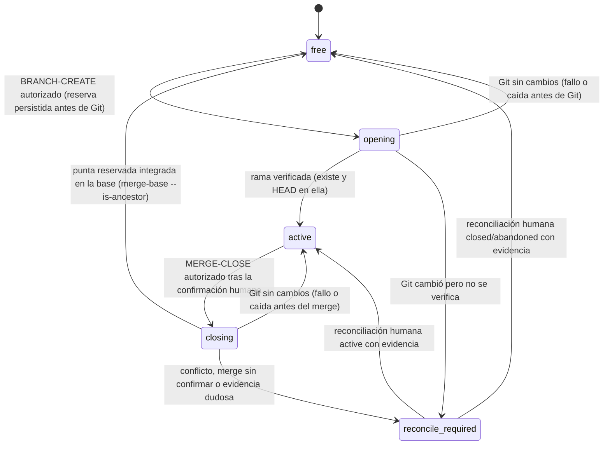

| Vista del proyecto | BRANCH-CREATE misma HU | BRANCH-CREATE otra HU |
| --- | --- | --- |
| `no_open_hu` | permitir (`HU_OPEN_ALLOWED`) | permitir |
| `one_open_hu` | reanudar sin abrir otra (`HU_OPEN_RESUME`) | rechazar (`HU_ANOTHER_OPEN`) |
| `opening` | reanudar | rechazar (`HU_OPENING_IN_PROGRESS`) |
| `closing` | rechazar (`HU_CLOSING_IN_PROGRESS`) | rechazar |
| `reconcile_required` / `unknown` | rechazar (`HU_RECONCILE_REQUIRED` / `HU_STATE_UNKNOWN`) | rechazar |

La vista combina la reserva `hu_authority` con la observación E3 en vivo; una reserva `active` que
Git no corrobora es `reconcile_required` y un fallo de observación es `unknown`, nunca "libre". El
watcher decide cada macro con el historial anterior a su línea. Secuencia autoritativa: lock `hu` →
revalidar Git, tracker y SQLite → reservar (`hu_op:<id>` estable por evento + `hu_authority`) →
ejecutar la macro → verificar Git → confirmar → liberar. La confirmación humana del cierre (`input`)
corre fuera del lock y la estrategia `--no-ff` no cambia.

Rechazo (corrección D5): la macro rechazada no ejecuta Git ni checkout, su evento termina `done` con
`outcome: rejected`, las tareas aún en cola de líneas anteriores del bloque se retiran y ninguna
línea posterior del mismo bloque se despacha (`outcome: suppressed`). Se emite un bloque `WATCHER`
con `@HUMANO:` (op_id `hu-notice-<id>`, idempotente), que además pausa el flujo. Las dependencias de
un bloque solo se despachan si su operación está `confirmed`: reconocer el evento (`state
--acknowledge`), reiniciar o una caída no las autorizan. Tras reiniciar, `recover()` resuelve una
reserva `opening`/`closing` interrumpida con evidencia Git (o la deja en `reconcile_required`), se
reemiten los avisos pendientes y la hidratación solo reactiva la HU abierta demostrada.

Repositorios compartidos (worktree enlazado o principal con worktrees enlazados, mismo
`git-common-dir`): sus ramas no se pueden atribuir a un proyecto y se rechaza con
`HU_SHARED_REPOSITORY`. Reconciliación humana: `python -m bmad_runtime.hu_enforcement --inspect` y
`--reconcile <HU> --as active|closed|abandoned --reason ... --confirm` (watcher detenido); se registra
en `hu_resolution:<HU>` ligada a la evidencia que resolvió, con autor, fecha e historial.

### Outbox de respuestas de agentes (Fase 4F-E5, `ai.outbox.mode`)

`direct` (por defecto) conserva el comportamiento anterior: el agente anexa su bloque al tracker.
`both` y `outbox` son opt-in (motor o `config.ai.outbox` del `project.json` de un proyecto aislado):
el despacho fija y persiste su canal; en canal outbox el agente publica un único archivo en
`<BMAD_HANDOFFS>/outbox/<event24>-<attempt>.md` entre marcas con la identidad del despacho y un
nonce, y el watcher es el único que lo escribe en el tracker con TrackerWriter (op_id
`outbox:<event_id>:<attempt>`). El canal pertenece al despacho: cambiar de modo y reiniciar no
reinterpreta despachos existentes, y un mismo despacho nunca acepta dos entregas.

```mermaid
stateDiagram-v2
    [*] --> expected: despacho persistido antes de enviar la tarea
    expected --> writing: archivo sin marca final
    writing --> ready: marca final con el nonce
    expected --> ready: publicación completa o rename atómico
    ready --> validating: contenido idéntico tras settle_seconds
    validating --> ingesting: identidad, rol, formato y macros válidos (intención persistida)
    ingesting --> confirmed: TrackerWriter done y bytes presentes; queued confirmado en la misma transacción
    validating --> rejected: inválido, rol o proyecto ajeno, macro no autorizada
    validating --> reconcile_required: despacho incierto, handoff reconocido o escalado, bloque directo
    ingesting --> reconcile_required: append incierto o perdido (nunca se repara solo)
    rejected --> [*]: reconocido por un humano (no entregado)
    reconcile_required --> rejected: --reject con el bloque ausente del tracker
```

Cada ciclo del watcher ingiere antes de leer el tracker: el bloque incorporado sigue el camino de
siempre (macros, enforce E4, extracción de handoffs, auditoría de protocolo). `audit_blocks` solo
acepta para un despacho outbox el bloque ingerido (`confirmed_block`); un bloque directo del agente
es una violación de protocolo. Rechazos e incertidumbres marcan el handoff `requiere_intervencion`,
emiten un bloque `WATCHER` con `@HUMANO:` y retienen los despachos hasta `python -m
bmad_runtime.outbox --acknowledge|--reject KEY --confirm`. El vigilante no confirma un despacho
outbox por un bloque del tracker: recuerda la ruta asignada y escala sin inventar respuesta.

Handoff humano (E5.1, ambos canales): bloque producido → incorporado y verificado → handoff confirmado
(técnico) → intervención humana pendiente → decisión humana recibida. La confirmación corre aunque el flujo
esté en pausa, pero la pausa solo la levanta un bloque humano posterior (`paused_for_human`); nada que
requiera aprobación se despacha antes. `python -m bmad_runtime.outbox --inspect` muestra los hitos, la
evidencia de cada entrega, los motivos de bloqueo y el procedimiento de recuperación.

Consistencia de configuración: el watcher persiste sus políticas efectivas (`watcher_policy`) y avisa
si su `--config` difiere de la configuración por defecto; `python -m bmad_runtime.outbox --status`
muestra las diferencias y el Control Center aplica `enforce` de HU si el watcher en ejecución lo usa.

### Mantenimiento supervisado (CLEAR, ROTATE y VERIFY)

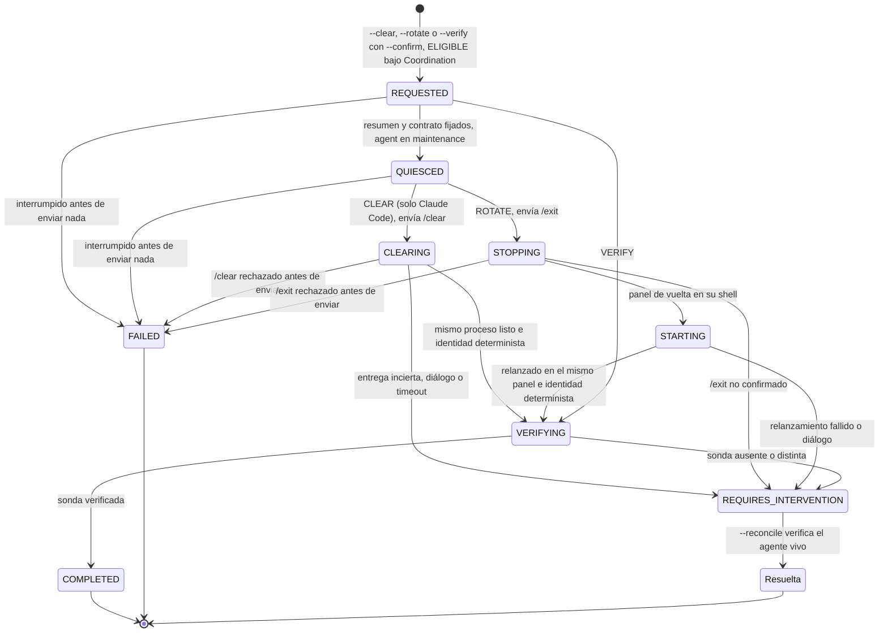

`Coordination` toma los locks `maintenance`, `watcher` (o exige un watcher con latido reciente),
`fleet` y `sessions`, y vuelve a evaluar la elegibilidad bajo exclusión. Una operación no final
bloquea al agente (`maintenance_blocks`) hasta `--reconcile`, que verifica el agente vivo, deja
`resolution` en la operación (que conserva su estado como evidencia) y nunca relanza ni reintenta.
`FAILED` significa verificado que nada llegó al agente: vuelve a `ready`. `--plan-clear` es de
solo lectura.

### Generaciones de sesión

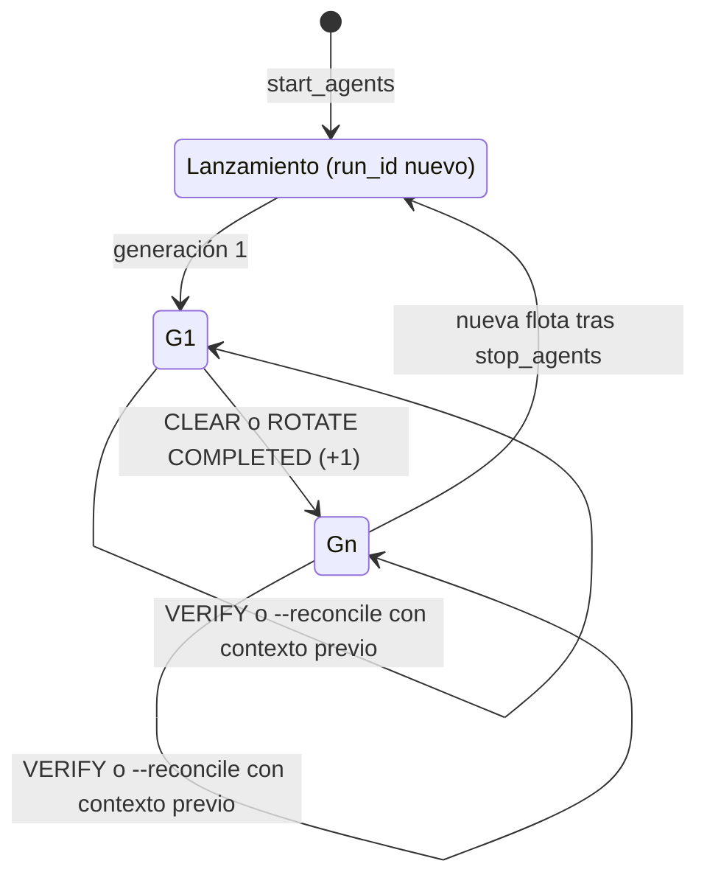

Una sesión es la pareja `run_id` + `generation` del registro `agent:<rol>`. Cada despacho guarda
la sesión que lo recibió; el plan considera una sesión ya renovada si un CLEAR o ROTATE terminó
después de su último handoff confirmado (`session_already_fresh`). `--reconcile` de un CLEAR o
ROTATE interrumpido solo suma una generación cuando la sonda demuestra contexto vacío.

### Context Budget y Loop Guard

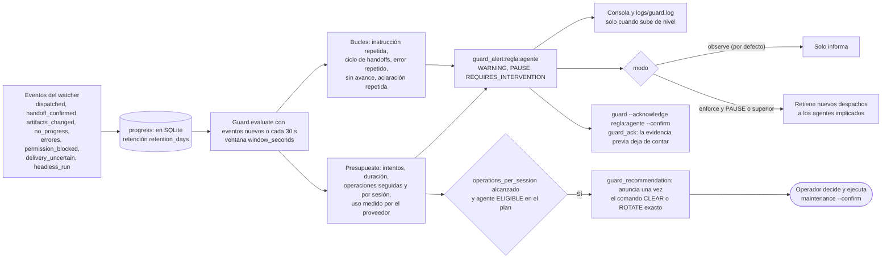

Cada métrica lleva su calidad: `measured`, `estimated` o `unavailable`. Las sesiones
interactivas no reportan tokens: el uso nunca dispara recomendaciones, y un límite de uso solo se
acepta si el proveedor mide esa métrica. El guard nunca limpia, rota, reintenta, responde diálogos
ni interrumpe una operación activa; `guard --status` y `--calibrate` son de solo lectura.

## 8. Secuencias

### Inicio de proyecto, agentes y persistencia

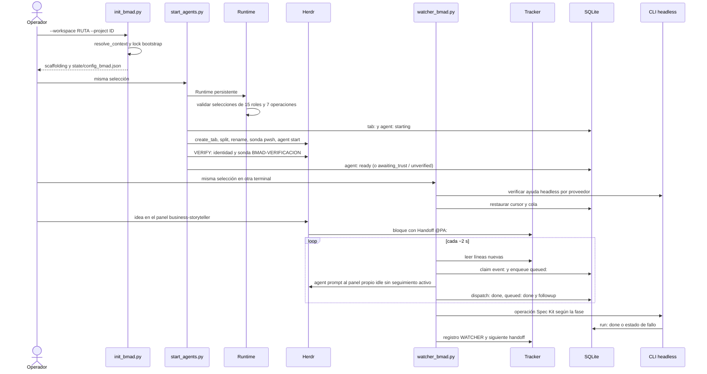

### Handoff entre agentes con aprobación humana

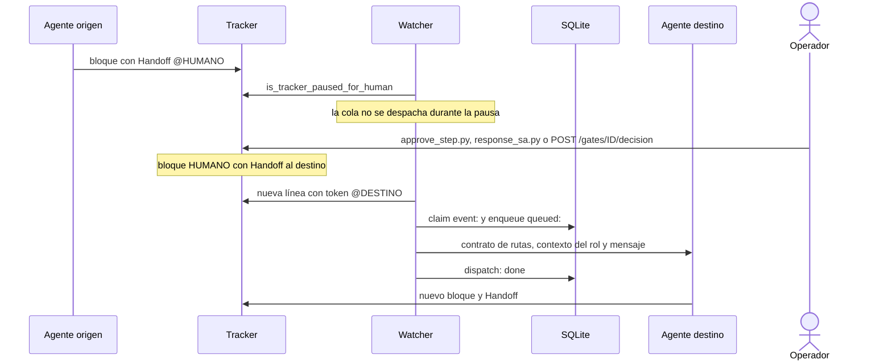

Un único token de destinatario por derivación. En un handoff al humano, los demás agentes se
nombran sin `@TOKEN:` para no disparar despachos. Las macros `@WATCHER: GITOPS-BRANCH-CREATE`,
`@WATCHER: SDD-FREEZE` y `@WATCHER: GITOPS-MERGE-CLOSE` van en líneas independientes antes del
handoff. El cierre de rama pide además escribir el nombre de la rama en la consola del watcher.

### Mantenimiento supervisado de una sesión

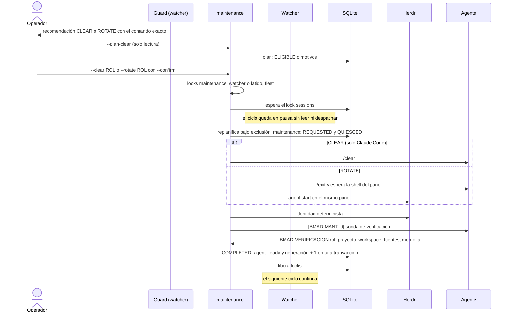

Cualquier fallo antes de enviar deja `FAILED` y el agente `ready`; tras un envío deja
`REQUIRES_INTERVENTION`, retiene al agente y exige `--reconcile ROL --confirm`.

### Recuperación tras fallos

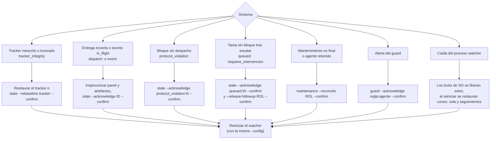

Ningún comando de recuperación repite una operación: marcan la evidencia como atendida o
verifican el estado vivo. Los comandos `state` exigen el watcher detenido (toman su lock). Un
conflicto en `GITOPS-MERGE-CLOSE` aborta el merge, escribe en el tracker el comando exacto para
reconciliar su evento y detiene el watcher; reiniciar sin reconciliar vuelve a detenerlo.

### Consulta del dashboard

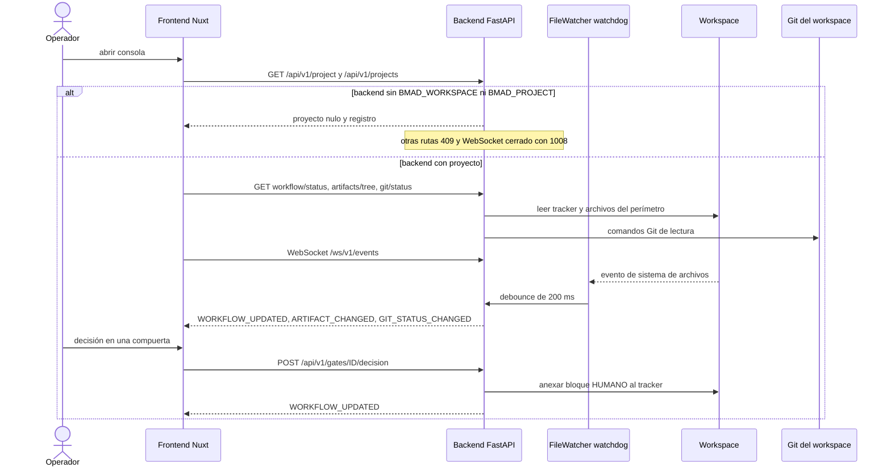

El backend observa `docs`, `specs`, `.specify`, `handoffs` y `.git` con watchdog. El
frontend usa REST para la carga inicial y el WebSocket para actualizaciones; el latido
PING/PONG mantiene la conexión. Las decisiones del dashboard llegan al watcher solo a través
del tracker.

### Resolución de contexto

```mermaid
sequenceDiagram
    participant C as Consumidor
    participant CTX as ProjectContext
    participant TC as technical_context.assemble
    participant P as ENGINE_ROOT/constitution.md
    participant WS as Workspace
    C->>CTX: instructions
    CTX-->>C: contrato de rutas y variables BMAD_*
    C->>TC: assemble con rol u operación
    TC->>P: ruta y texto si ocupa 7000 caracteres o menos
    TC->>WS: document_index
    Note over TC,WS: constitución local siempre, y para roles técnicos tech-stack.md, architecture.md, tech_guidelines.md, guías, roles y ADRs existentes
    TC->>WS: constitución local completa si ocupa 6000 caracteres o menos
    opt rol técnico u operación plan, tasks, analyze, converge o implement
        TC->>WS: discover manifests acotado
        TC-->>TC: observaciones y diferencias con tech-stack.md
    end
    TC-->>C: índice y TAREA ACTUAL con límite de 24000 caracteres
```

| Consumidor | Composición del prompt |
|---|---|
| Arranque del panel (`interactive_command`) | contrato de rutas + `assemble(role, compact=True)`: solo rutas de política y documentos, hasta 8 observaciones |
| Despacho (`AgentDispatcher.dispatch`) | contrato + `assemble(role)` completo + mensaje del tracker |
| Spec Kit (`SpecKitExecutor.prepare`) | `assemble(operation)` + contrato + ruta absoluta de la skill `speckit-<operación>` + argumentos |

El encabezado fija la precedencia: política operativa del motor para aislamiento y seguridad;
constitución local para restricciones técnicas; ADR aprobado para decisiones particulares. Una
propuesta, un plan o una dependencia observada no equivalen a aprobación. Las guías largas se
enlazan para lectura bajo demanda. `discover()` no ejecuta scripts, omite secretos, enlaces y
workspaces anidados, y limita a 512 000 bytes por archivo, 2 000 directorios y 300 observaciones.

## 9. Orquestación

Un proceso watcher fija sus rutas globales al workspace con `configure_project()`; no cambia de
proyecto en caliente. Cada proyecto necesita su propio launcher, watcher y backend de dashboard.

### Ejemplo 1: un proyecto activo

Nombres ficticios: proyecto `agenda-citas`, workspace `D:\Proyectos\Agenda`.

```mermaid
flowchart LR
    OP(["Operador"]) -->|"--project agenda-citas"| REG["config_bmad.json<br/>projects.agenda-citas"]
    REG --> CTX["ProjectContext<br/>agenda-citas"]
    CTX --> L["start_agents.py"]
    CTX --> W["watcher_bmad.py"]
    L -->|"3 tabs agenda-citas-hash-*"| H["Herdr"]
    H --> P1["Paneles BS, PA, PM, BA, QA, UX"]
    H --> P2["Paneles SA, DA, API, QT"]
    H --> P3["Paneles QA-AUTO, CODE-REVIEW, DEVOPS"]
    W -->|"despacho"| H
    W -->|"recomendaciones"| OP
    OP -->|"maintenance --confirm"| MNT["maintenance<br/>--project agenda-citas"]
    MNT -->|"lock sessions: pausa el ciclo"| W
    MNT -->|"/clear, /exit, agent start"| H
    W -->|"Spec Kit headless"| SK["CLI headless"]
    P1 & P2 & P3 --> T[("Agenda/handoffs/tracker_bmad.md")]
    T --> W
    SK --> A[("Agenda/specs, app")]
    W --> S[("Agenda/state/state.sqlite3")]
    D["Backend :8000<br/>BMAD_PROJECT=agenda-citas"] --> T
    UI["Frontend :3000"] --> D
```

### Ejemplo 2: dos proyectos simultáneos

Nombres ficticios: `agenda-citas` y `inventario`, registrados en el mismo motor.

```mermaid
flowchart TB
    subgraph Motor["ENGINE_ROOT compartido: código, perfiles, skills, config global"]
        RA["Proceso launcher A<br/>Proceso watcher A<br/>maintenance A bajo demanda"]
        RB["Proceso launcher B<br/>Proceso watcher B<br/>maintenance B bajo demanda"]
        DA["Backend :8001<br/>BMAD_PROJECT=agenda-citas"]
        DB["Backend :8002<br/>BMAD_PROJECT=inventario"]
    end
    subgraph HerdrSrv["Herdr: un servidor"]
        HA["Tabs y paneles<br/>agenda-citas-hashA-rol"]
        HB["Tabs y paneles<br/>inventario-hashB-rol"]
    end
    subgraph WA["Workspace A"]
        TA[("tracker A")]
        SA[("state A: SQLite, locks,<br/>agent:, maintenance:, guard_*")]
        AA[("docs, specs, app, logs A<br/>logs/guard.log")]
        GA[("Git A")]
    end
    subgraph WB["Workspace B"]
        TB[("tracker B")]
        SB[("state B: SQLite, locks,<br/>agent:, maintenance:, guard_*")]
        AB[("docs, specs, app, logs B<br/>logs/guard.log")]
        GB[("Git B")]
    end
    RA --> HA
    RB --> HB
    RA --> TA & SA & AA & GA
    RB --> TB & SB & AB & GB
    HA --> TA
    HB --> TB
    DA --> TA & AA
    DB --> TB & AB
    UA["Frontend :3001<br/>VITE_BMAD_API_BASE=:8001"] --> DA
    UB["Frontend :3002<br/>VITE_BMAD_API_BASE=:8002"] --> DB
```

Mecanismos contra la contaminación cruzada:

- **Rutas:** `ProjectContext.output()` resuelve cada escritura dentro del workspace y rechaza
  escapes; los procesos hijos reciben `cwd` y variables `BMAD_*` del proyecto, y `CommandRunner`
  elimina variables heredadas de feature/Git.
- **Sesiones:** los nombres incluyen ID y hash de la ruta normalizada; el launcher rechaza nombres
  existentes y el despacho exige propiedad registrada en el SQLite del proyecto.
- **Estado:** SQLite, cursor, cola y locks viven en `state/` de cada workspace. Un segundo
  watcher sobre el mismo workspace falla al tomar el lock; sobre otro workspace no compite.
- **Git:** `GitService` exige `.git` local en el workspace y rechaza un repositorio padre.
- **Sesiones y guard:** generaciones, operaciones de mantenimiento, alertas y recomendaciones viven
  en el SQLite del workspace; los locks `maintenance` y `sessions` coordinan solo procesos del
  mismo proyecto. Los comandos recomendados incluyen `--workspace`, `--project` y la `--config`
  del watcher; `stop_agents.py --config` resuelve el proyecto con ese mismo archivo y rechaza un
  `project.json` que no coincida.
- **Dashboard:** cada backend fija un proyecto al importarse; HTTP, WebSocket, observadores y
  cachés pertenecen a ese proceso.

Limitaciones actuales:

- No existe orquestador central ni selector global: la simultaneidad consiste en procesos
  independientes por proyecto, que el operador arranca y supervisa por separado.
- El dashboard no agrega proyectos: la portada lista el registro (`/projects`), pero cada
  supervisión requiere un backend y un frontend propios; `VITE_BMAD_API_BASE` se fija al
  arrancar o compilar el frontend.
- `ai.limits.max_processes` limita cada `CommandRunner`, no el total de la máquina.
- El aislamiento de dos workspaces está verificado con dobles (`tests/test_multiworkspace.py`,
  `tests/validate_offline.py`); no hay prueba automatizada de dos flotas reales en un mismo
  Herdr ni de cuota compartida entre proveedores.

## 10. Límites de seguridad y operación

- El perímetro de rutas es una regla del runtime y del contrato inyectado, no un sandbox del
  sistema operativo: un CLI externo puede ejecutar acciones arbitrarias según sus permisos.
- En Windows, `CommandRunner` exige ejecutables nativos y rechaza `.cmd`, `.bat` y `.ps1`.
- Gemini, una skill instalada distinta de `.github/skills`, una configuración inválida o un CLI
  ausente producen errores explícitos; no hay fallback de proveedor.
- `idle`/`done` en Herdr o la aceptación de un prompt no prueban que el agente terminó: cuentan
  el artefacto y el handoff.
- No hay limpieza ni rotación automática de contexto: `/clear` (solo Claude Code) y la rotación
  son operaciones confirmadas por el operador ([SETUP.md](SETUP.md#ciclo-de-vida-de-sesiones)).
- Un agente solo recibe tareas en estado `ready`, tras una verificación (arranque, recuperación,
  CLEAR, ROTATE). El watcher es el único despachador: un bloque de agente sin despacho detiene los
  despachos hasta reconciliar. Los diálogos de confianza nunca se responden automáticamente
  ([SETUP.md](SETUP.md#arranque-y-entrega-en-herdr)).
- `ai.git.auto_commit=false` desactiva el autosave; el freeze y las macros GitOps siguen creando
  commits, ramas y merges. El freeze exige staging vacío y añade solo `specs/` y `.specify/`.
- `Runtime` cachea la configuración: un cambio requiere reiniciar los procesos afectados.
- Un despacho abre un seguimiento por agente: hasta su bloque en el tracker (o la escalada del
  vigilante) ese agente no recibe otra tarea, aunque Herdr lo muestre `idle`.

### Deuda técnica conocida

- **Outbox (E5/E5.1) sin piloto real:** el protocolo está verificado con dobles de Claude, Codex y Herdr;
  falta comprobar en vivo que cada CLI publica el archivo con sus herramientas de edición y respeta las
  marcas. Las sesiones headless de Spec Kit siguen sin canal outbox: un bloque suyo (`DEV-BACK`/`DEV-FRONT`)
  se audita (`blocked_write:`) y no ejecuta ni despacha nada; con una macro, además, pausa con `@HUMANO:`.
  Un bloque con autor del motor (`WATCHER`, `Senior … Developer`) cuya cabecera no está en el journal de
  TrackerWriter se trata igual. Las líneas sin cabecera anexadas a un bloque ajeno siguen sin atribución.
  En modo `direct`, un agente interactivo aún puede emitir una macro que su contrato no le asigna: los
  contratos ya no la ordenan (prueba de contratos), pero solo el canal outbox lo rechaza.

- **Ventana entre consulta y despacho:** el watcher lee el estado del agente en Herdr
  (`obtener_info_agente`) y `AgentDispatcher.dispatch` lo vuelve a consultar antes de enviar. Si
  el agente cambia de estado entre ambas lecturas, el despacho lanza `ReconciliationRequired` y el
  watcher se detiene sin enviar nada (fallo seguro, sin duplicados); la tarea sigue en cola al
  reiniciar. No hay bloqueo atómico con Herdr.
- **Harness de pruebas:** `tests/run_isolated.py` conserva a propósito cada directorio temporal
  bajo `.test-tmp/` (ignorado por Git) para sortear las ACL heredadas de Windows; crece con cada
  ejecución y se limpia a mano. Las pruebas que usan el modo legacy emiten `FutureWarning` por no
  seleccionar workspace, y el backend arrastra un aviso de deprecación de `httpx` en
  `starlette.testclient`.
- **Fin de línea:** el repositorio no tiene `.gitattributes`; con `core.autocrlf=true`, Git avisa
  de conversiones LF a CRLF en archivos editados con LF.
